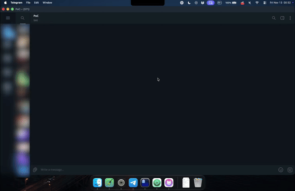

# telegram-quickjs-rce

RCE in Telegram Desktop via bot widgets. Works on **Windows x64**, **macOS arm64** and **Linux** (x64/arm64).

Telegram Desktop 7.4.0–7.4.2 runs bot widgets in a sandbox powered by QuickJS. A use-after-free in the generator prologue ([quickjs-ng #1910](https://github.com/quickjs-ng/quickjs/issues/1910)) gives arbitrary read/write inside the widget sandbox. The PoC escapes the sandbox and executes a command from the Telegram Desktop process.

**`poc-universal.html`** detects the host OS at runtime (PE / Mach-O / ELF image header walk) and runs the matching final stage — one file for all platforms.

Per-platform PoCs (same UAF primitive, only the final call differs per OS):

| File | OS | Payload | SHA-256 |
|---|---|---|---|
| `poc-universal.html` | all of the below | runtime detect | `503e5c7536016d44075765d1dd62800e7aa446a25dca6b3fc398f8f9a9ab8459` |
| `poc-win.html` | Windows x64 | `WinExec` → `calc.exe` | `3e2cbc65f8dcb29e2ae78879554f72ad7f3bf48509467d43d60e1e2f346d3347` |
| `poc-macos.html` | macOS arm64 | `system("open -a Calculator")` | `ac512ff672ac894ed074c126b1f331ae2d739ddf0dfcb6f37541ba78ecfd4f2b` |
| `poc-linux.html` | Linux x64/arm64 | `system("touch /tmp/pwned")` | `a421bd4a2d1f8e7c47d888f64b160d77ecef57d19bedf8ba06866bd87d0a2337` |

The universal PoC opens the Calculator on Windows and macOS; on Linux (no calculator in a headless environment) it creates `/tmp/pwned`.

Tested on Telegram Desktop 7.4.2 (official builds); the Linux and universal PoCs were verified in the widget-sandbox harness built with the same QuickJS pin (8f0d3b6) on Debian x64 and arm64.

## Demo

<video src="demo.mp4" controls muted width="600"></video>



Calculator launched from the Telegram Desktop process on macOS arm64 (Telegram Desktop keeps running).

## Usage

Send the PoC to yourself as a widget via the Bot API (`sendWidget`), then open the chat in a vulnerable Telegram Desktop:

```bash
curl -s -X POST "https://api.telegram.org/bot<TOKEN>/sendWidget" \
  -H "Content-Type: application/json" \
  -d "$(python3 -c 'import json; print(json.dumps({"chat_id": <YOUR_ID>, "html": open("poc-universal.html").read()}))')"
```

When you open the message in the chat, the command executes and Telegram Desktop keeps running.

## Credits

- Original research and Windows PoC: [bikini/telejam](https://github.com/bikini/telejam)
- macOS and Linux ports: [@umbra2728](https://github.com/umbra2728)
